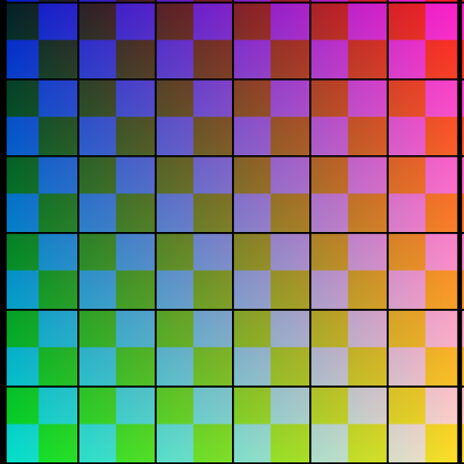
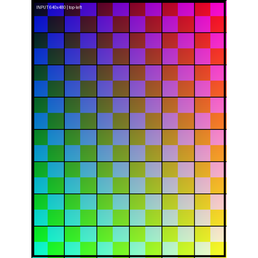

# 图像预处理与交替注意力

图像处理同时改变像素内容和几何坐标；token 分组决定哪些视图可以直接交换信息。
本项目用三张诊断图核对官方预处理，crop 与 pad 的计划重建结果均达到 **最大像素误差 0.0**；另以均值小实验观察 Frame/Global 的传播范围。
相关教学函数通过 **24/24 项检查**，没有把这些小实验当作真实注意力或重建精度验证。

## 缩放、裁剪与两级补边

三张输入分别是横图、竖图和透明方图，不属于同一个三维场景。
官方 CPU helper 与教学计划驱动处理均使用同一 Pillow resize，输出 float32、值域 `[0,1]`。
下表尺寸均按 H × W；补边记为 `(top,bottom,left,right)`。

| 模式 / 图像 | 原始尺寸 | resize 后 | 上方裁切 | 模式补边 | 拼组补边 | 最终尺寸 |
|---|---|---|---:|---|---|---|
| crop / 横图 | 480×640 | 392×518 | 0 | 0,0,0,0 | 63,63,0,0 | 518×518 |
| crop / 竖图 | 640×480 | 686×518 | 84 | 0,0,0,0 | 0,0,0,0 | 518×518 |
| crop / 方图 | 480×480 | 518×518 | 0 | 0,0,0,0 | 0,0,0,0 | 518×518 |
| pad / 横图 | 480×640 | 392×518 | 0 | 63,63,0,0 | 0,0,0,0 | 518×518 |
| pad / 竖图 | 640×480 | 518×392 | 0 | 0,0,63,63 | 0,0,0,0 | 518×518 |
| pad / 方图 | 480×480 | 518×518 | 0 | 0,0,0,0 | 0,0,0,0 | 518×518 |

| crop：竖图上下裁切 | pad：竖图左右补边 |
|---|---|
|  |  |

横图单独 crop 的 shape 是 `(1,3,392,518)`，并不强制方形；与另外两张图拼组时才上下各补 63 行。
pad 在单图阶段补边，因此本组最终横图虽然相同，处理阶段不同。
透明方图先与白底合成，白色透明区域不能误认为新增 padding。

[crop 报告](results/preprocessing/preprocess_crop.json)和[pad 报告](results/preprocessing/preprocess_pad.json)均记录：
`actual_batch_shape=[3,3,518,518]`、`plan_pixel_max_abs_error=0.0`、`plan_pixel_comparison_passed=true`。
它们同时记录 `model_executed=false`、`weights_loaded=false`；零误差只证明这组输入与这两条处理路径的一致性。

## 处理后的坐标与内参

设原图零起点像素中心为 `(u,v)`，实际 resize 比例为 `sx=W_resized/W_original`、`sy=H_resized/H_original`。
将原图坐标映射到最终处理网格的教学仿射矩阵 A 满足：

```math
u'=(u+0.5)s_x-0.5+p_{\mathrm{left}},\qquad
v'=(v+0.5)s_y-0.5-c_{\mathrm{top}}+p_{\mathrm{top}}.
```

padding 包含模式补边和拼组补边。resize 高宽对齐到 14 的倍数后，两轴比例不必完全相等。
横图实际为 `sx=518/640=0.809375`、`sy=392/480≈0.816667`；拼组后的变换为：

```text
A ≈ [[0.809375, 0,          -0.0953125],
     [0,        0.81666667, 62.90833333],
     [0,        0,           1         ]]
```

报告中的横图中心 `(319.5,239.5)` 映射至 `(258.5,258.5)`。
竖图 crop 的 `(0,0)` 映射到约 `(0.039583,-83.964063)`；落在图外表示该内容已裁掉，不能强行 clip 回边界。
已有相机标定采用相同坐标约定时，内参应变换为 `K_new=A K_old`。
A 是教学元数据，既不是官方 helper 返回值，也不是三维相机外参；逆坐标变换不能恢复裁掉的内容或丢失的分辨率。

## Frame 与 Global 怎样组织 token

以下结构来自锁定源码的静态核对，见[源码检查](results/preprocessing/source_check.json)。
默认 patch 大小为 14、特征宽度 C=1024，每视图加入 1 个 camera token 和 4 个 register token。
令 `P=N_patch+5`，则两种注意力的序列布局为：

| 阶段 | 形状 | 可以直接交换信息的范围 |
|---|---|---|
| 图像 patch 特征 | `(B*S,N_patch,C)` | 每张图的视觉特征 |
| 加入特殊 token | `(B,S,P,C)` 的逻辑布局 | 保留独立样本与视图 |
| Frame | `(B*S,P,C)` | 单个视图内部 |
| Global | `(B,S*P,C)` | 同一样本的全部视图，包括本视图 |
| 缓存给预测头的特征 | `(B,S,P,2C)` | 同层 Frame/Global 结果沿特征轴拼接 |

Global 是合并序列上的 self-attention，不是只能看其他图的 cross-attention；它不合并独立的 B 维。
默认 `aa_order=["frame","global"]`、`aa_block_size=1`、depth=24。
缓存索引为 4、11、17、23；传入下一轮的主干 token 仍是 C 维，不会每轮翻倍。
两套首图/其余图特殊 token 初值不表示每张图加入两个 camera token。

对本组 518×518 图像，静态推导得到 `N_patch=37×37=1369`、`P=1374`。
若按默认模型联合输入三图，Frame 应为 `(3,1374,1024)`，Global 为 `(1,4122,1024)`。
这是形状推导，没有在这三张诊断图上执行 Aggregator。

## 均值小实验：信息能传播到哪里

实验输入 `(B,S,P,C)=(2,3,4,2)`，给索引 `[0,1,0,0]` 加 12，再在各分组内求均值并回填。
这一步的传播来自求均值；仅重排数组不会改变 token 的值。

| 处理 | 分组形状 | 样本 0 三个视图的最大变化 | 样本 1 三个视图的最大变化 |
|---|---|---|---|
| Frame | `(6,4,2)` | `[0,3,0]` | `[0,0,0]` |
| Global | `(2,12,2)` | `[1,1,1]` | `[0,0,0]` |
| Global 后再 Frame | 先合组、再逐图 | `[1,1,1]` | `[0,0,0]` |

Frame 将扰动均分给本视图 4 个 token，得到 `12/4=3`；Global 均分给同一样本 12 个 token，得到 `12/12=1`。
Global 之后的 Frame 接收的输入已有跨图信息，因此即使当前层只在图内处理，跨图影响仍可保留。
实验中的 Global→Frame 顺序用于说明这一点，不是默认源码 Frame→Global 的执行日志。

[实验 JSON](results/preprocessing/attention_demo.json)明确标记 `model_executed=false`、`learned_attention=false`。
真实 attention 还包括由特征构造 Q/K/V、学习权重、输出投影以及 block 的残差和 MLP。
均值实验说明传播范围，不证明模型学会了匹配或三维推理。

## 验证范围

[24 项检查](results/preprocessing/checks.json)分别覆盖预处理计划、像素仿射和 token 分组，各 8 项。
检查包含实际两轴缩放、内参投影一致性、索引保持、非连续数组和不同 batch 不混合。
它们与 CPU 像素比较共同建立了输入处理依据；真实同场景照片、权重和 GPU 前向见[推理专题](03_Inference_and_Runtime_Diagnostics.md)。

[返回项目总览](README.md)
