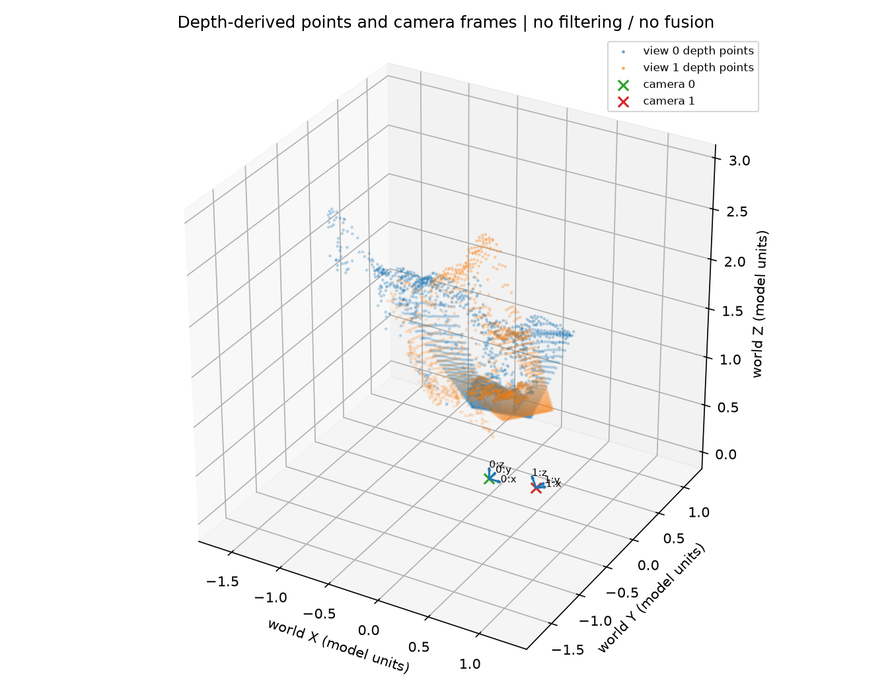

# 相机、深度与共享世界坐标

预测深度必须与对应网格的内参、正确方向的外参一起使用，才能还原为世界点。
本模块在已保存的联合双图预测上完成反投影、同视图回投和官方实现对照。
两幅图均通过算术检查；这些结果验证转换链路的一致性，尚未证明真实场景几何准确。

## 从相机 Z 到世界点

保存的外参为 OpenCV `w2c=[R|t]`，满足：

```math
P_c=RP_w+t,\qquad C=-R^{\mathsf T}t,
\qquad P_w=R^{\mathsf T}P_c+C.
```

相机中心是 $C$，通常不是平移列 $t$。对应 `c2w` 的旋转为 $R^{\mathsf T}$，平移为 $C$。
对当前处理网格上的整数像素中心 $(u,v)$，反投影为：

```math
P_c=ZK^{-1}[u,v,1]^{\mathsf T}
=\left[(u-c_x)Z/f_x,\ (v-c_y)Z/f_y,\ Z\right]^{\mathsf T}.
```

这里的 $Z$ 是当前相机轴向深度，不是沿单位射线的距离，也不是世界坐标的 Z。
处理网格为 H×W=350×518，数组按 `[v,u]` 访问；K 必须与此网格对应。
本次没有给整数像素中心额外加 0.5，也没有自行把主点改为 `((W−1)/2,(H−1)/2)`。

## 实际相机与深度

输入顺序为 `00.png`、`01.png`；B=1、S=2，每幅图有 181,300 个像素。
下表的焦距和主点单位为像素，相机位置与深度单位为模型单位。

| 视图 | fx | fy | cx | cy | 世界中的相机中心 C |
|---|---:|---:|---:|---:|---|
| 0 | 516.557129 | 516.788513 | 259 | 175 | (−0.000033162, 0.000021678, −0.000029500) |
| 1 | 512.159851 | 511.858429 | 259 | 175 | (0.521037260, −0.075130822, 0.107772438) |

两相机中心距离为 **0.5373858393 模型单位**，没有标定为米。
首相机接近单位变换但并不精确相等，实际 `||R₀−I||F=1.08630e-4`、`||t₀||=4.93952e-5`。
分析保留这些原始预测，没有强制将首相机重置为恒等变换。

| 视图 | 有效 Z / 全部像素 | Z 最小值 | Z 最大值 | Z 均值 |
|---|---:|---:|---:|---:|
| 0 | 181,300 / 181,300 | 0.536203623 | 2.654783726 | 1.188833630 |
| 1 | 181,300 / 181,300 | 0.527382374 | 2.574283600 | 1.070852799 |

有效条件为 `finite(depth) & (depth > 1e-6)`；阈值使用模型单位。
无效点应保留三个 NaN 坐标。全部像素数值有效，不代表它们全部具有可靠的场景几何。
完整相机参数与统计见 [cameras.csv](results/geometry/cameras.csv) 和 [analysis.json](results/geometry/analysis.json)。

## 同视图回投检查

用同一组 K、w2c 将反投影的世界点投回原视图，比较二维像素距离和相对 Z 差异。
最大 UV≤0.01 px、最大相对 Z≤1e-4 是本实验的教学算术阈值，不是官方场景精度标准。

| 视图 | 可比较点数 | 最大 UV 误差 / px | 最大相对 Z 误差 | 算术检查 |
|---|---:|---:|---:|---|
| 0 | 181,300 | 4.898279910e-7 | 3.705177352e-9 | 通过 |
| 1 | 181,300 | 2.618337152e-5 | 2.728371395e-8 | 通过 |

相对 Z 误差为 `abs(Z回投−Z输入)/Z输入`，无单位；两个视图都没有丢失原本有效的点。
保存的旋转为 float32，存在微小非正交误差；提升到 float64 运算不能恢复保存时丢失的信息。
因此使用转置构造刚体逆后，回投误差可以很小但不完全为零。

## 官方 helper 与三个反例

与锁定源码版本的 `unproject_depth_map_to_point_map` 比较，在相同有效 mask 内逐元素检查 `rtol=5e-5, atol=1e-6`。
两幅图各比较 181,300 点，最大点距离分别为 **6.60772e-8 / 1.03680e-7 模型单位**，对照通过。
点距离描述差异；通过条件是逐元素容差，详见 [official_comparison.json](results/geometry/official_comparison.json)。

独立构造的三个反例使用同一组 15 个合成点，全部具有有效正深度投影：

| 合成条件 | 最大 UV 误差 / px | 最大相对 Z 误差 | 能说明的问题 |
|---|---:|---:|---|
| 仅投影端将 c2w 当作 w2c | 6.559154 | 0.333333 | 变换方向不一致会破坏往返 |
| 将 Z 数值当作单位射线距离 | 2.22e-16 | 0.142857 | UV 几乎不变仍可隐藏深度语义错误 |
| 深度和全部平移共同乘以 2 | 2.22e-16 | 0（对照同步缩放后的深度） | 投影不能独立确定全局尺度 |

这些是合成契约实验，不是对真实双图修改后的结果。原始记录见 [counterexamples.json](results/geometry/evidence/counterexamples.json)。

## 点云预览与结论边界



预览按图像网格 stride=8 抽样，每视图显示 2,860 点，共 5,720 点。
这是抽样散点图，未做置信度筛选、去重、遮挡处理或表面融合；二维显示中的重叠不能证明表面对齐。
深度 PNG 共用 2%–98% 分位数显示范围 0.6066021812–2.2944102812，显示裁剪不改写数组。
抽样与显示约定见 [preview.json](results/geometry/preview/preview.json)。

24/24 解析与边界检查通过，见 [检查记录](results/geometry/evidence/day4_check.json)。
同视图往返和官方 helper 都使用同一批预测，不能充当独立深度、位姿或尺度真值。
下一模块比较共享参考系中的两种输出：[点图与置信度](05_Point_Maps_and_Confidence.md)。

[返回项目总览](README.md)
