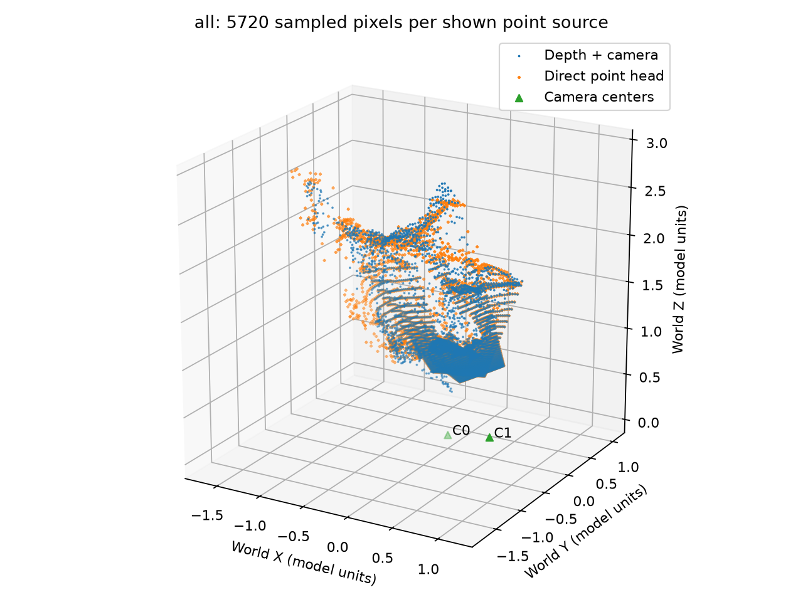
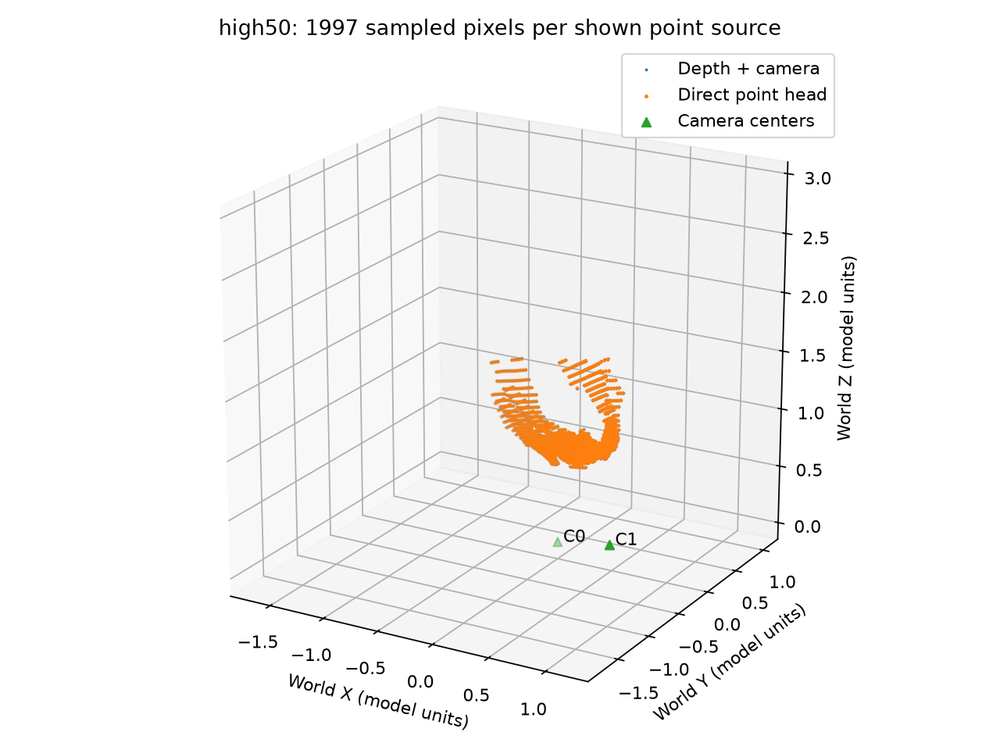
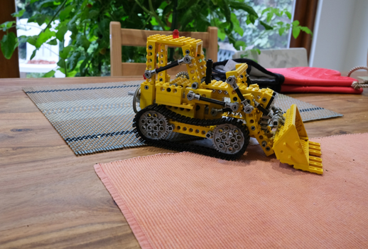
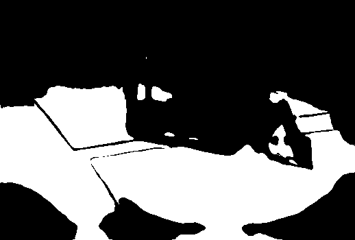

# 两路点图与置信度筛选

同一批图像会产生“深度＋相机反投影”和“直接点图头”两路世界点。
本模块比较同像素预测分歧，并观察置信度筛选造成的一致性与覆盖范围变化。
严格筛选后平均分歧由 0.05643840 降至 0.00283589 模型单位，同时共同覆盖率由 100% 降至 34.98%。

## 两种世界点如何比较

深度路线来自预测 depth、K 和 w2c 的反投影；直接路线来自模型的 `world_points`。
二者已经处于同一预测世界坐标系。直接点图不能再乘一次 c2w，否则会重复变换。
本次没有额外进行尺度对齐、居中、坐标归一化或融合。

对于相同 `(b,s,v,u)` 像素，两路距离定义为：

```math
d_{b,s,v,u}=\|P^{\mathrm{depth}}_{b,s,v,u}-P^{\mathrm{direct}}_{b,s,v,u}\|_2.
```

计算前将坐标提升为 float64；无效位置为 NaN。
这个距离是两路预测分歧，不是真值误差、最近邻 Chamfer 距离或回投像素误差。
二者都可能共同出错，因此一条路线不能被直接当作另一条的真值。

## 置信度不是概率

锁定源码中的 depth head 和 point head 均使用 `conf_activation="expp1"`：

```math
c=1+\exp(c_{\mathrm{raw}}).
```

它不是 `exp(x)−1`。数学上大于 1，有限精度输出可舍入到 1.0；分数 2 不表示 200% 正确率。
保存的分数已经激活，不再重复激活，也不裁剪到 `[0,1]`。
本次深度置信度范围为 `[1.0,21.41529274]`，直接点图为 `[1.0,24.75915909]`。

深度路线使用 `depth_conf`，直接路线使用 `world_points_conf`，分别筛选后再取共同像素。
`depth_conf` 没有传播姿态、内参与深度的联合不确定性，不能作为整条几何链的误差界。

## 分位数筛选与并列分数

每张图、每个分支在各自有限候选集合内计算线性分位数；请求保留比例为 $f$：

```math
\tau=Q_{1-f}(c),\qquad \mathrm{keep}=(c\geq\tau).
```

high75 对应第 25 百分位，high50 对应第 50 百分位。
阈值处的并列分数全部保留，不为凑数量按像素顺序打破并列。
该规则与官方演示中展平所有视图求阈值的规则不同，不能假定同一百分比得到相同 mask。

| 档位 | 视图 | 深度阈值 | 直接点图阈值 | 每个分支实际保留数 / 181,300 |
|---|---:|---:|---:|---:|
| all | 0 / 1 | 1.00000000 | 1.00000000 | 181,300（100%） |
| high75 | 0 | 1.00000000 | 1.00000000 | 181,300（100%） |
| high75 | 1 | 1.01935613 | 1.75803685 | 135,975（75%） |
| high50 | 0 | 9.69174576 | 7.09198833 | 90,650（50%） |
| high50 | 1 | 10.51439095 | 11.02100086 | 90,650（50%） |

high75 在图 0 上没有排除任何像素，两幅图合计每个分支保留 87.5%，并非固定 75%。
单分支保留数、两分支交集数和预览抽样点数是三个不同数量。

## 实际分歧与覆盖范围

输入为联合双图 full 预测，处理网格 B/S/H/W=1/2/350/518，共 362,600 个像素。
下表直接汇总所有保留像素，来自 `scope=paired, view_index=ALL`，没有简单平均视图分位数。
距离列均为模型单位，尚未标定为米。

| 档位 | 可比较候选数 | 共同保留数 | 全处理网格覆盖率 | mean | median | p95 | RMSE |
|---|---:|---:|---:|---:|---:|---:|---:|
| all | 362,600 | 362,600 | 100.0000% | 0.05643840 | 0.00384661 | 0.36727088 | 0.15846840 |
| high75 | 362,600 | 312,731 | 86.2468% | 0.03912366 | 0.00348263 | 0.25000343 | 0.13048364 |
| high50 | 362,600 | 126,854 | 34.9846% | 0.00283589 | 0.00259470 | 0.00449167 | 0.00302062 |

候选内保留比例的分母是候选数；处理网格覆盖率的分母是全部 `B×S×H×W` 像素。
本次候选恰好覆盖全网格，因此两种比例数值相同；它们都不是三维唯一表面的完整度。
完整逐图结果与阈值见 [selection_summary.csv](results/confidence/selection_summary.csv)。

| all：完整候选集合 | high50：两路高置信交集 |
|---|---|
|  |  |

点图按固定 stride=8 和固定坐标范围显示，all/high75/high50 每个点来源分别显示 5,720/4,906/1,997 点。
可视化与 PLY 都未做去重或表面融合，显示点数不是上表的全分辨率统计样本数。

## 严格筛选排除了什么

| 输入视图 0 | high50 两路交集 mask，白色为保留 |
|---|---|
|  |  |

本次 high50 主要留下桌面，同时排除了上方背景和黄色推土机模型的大部分区域。
若关心推土机本身的几何，筛选会牺牲目标覆盖；这里没有通过语义分割量化目标损失比例。
[残差图 0](results/confidence/preview/residual_all_view00.png) 与 [残差图 1](results/confidence/preview/residual_all_view01.png) 中，较大分歧可见于植物、窗边及背景轮廓附近。
残差显示统一使用 `[0,0.3672708807]`，超出范围会饱和，不能从最亮区域定位绝对最大值。

## 验证与使用边界

24/24 检查通过，三档真实比较都有配对样本，见 [比较记录](results/confidence/comparison.json) 和 [检查记录](results/confidence/evidence/day5_check.json)。
[三个构造实验](results/confidence/evidence/mask_experiments.json) 分别验证：保留比例不同于绝对阈值、并列分数使实际比例超出目标、两路各自有样本仍可能交集为空。
空交集的距离统计为 `null`，不能写成零误差。

更小的分歧只描述筛选后留下的集合，不能解释为原始模型预测已经改善。
当前没有真值精度、米制尺度或置信度校准证据，也没有独立的天空、反射与 padding mask。
跨视图还需要另一类检查，见 [双方向深度一致性](06_Cross_View_Consistency.md)。

[返回项目总览](README.md)
