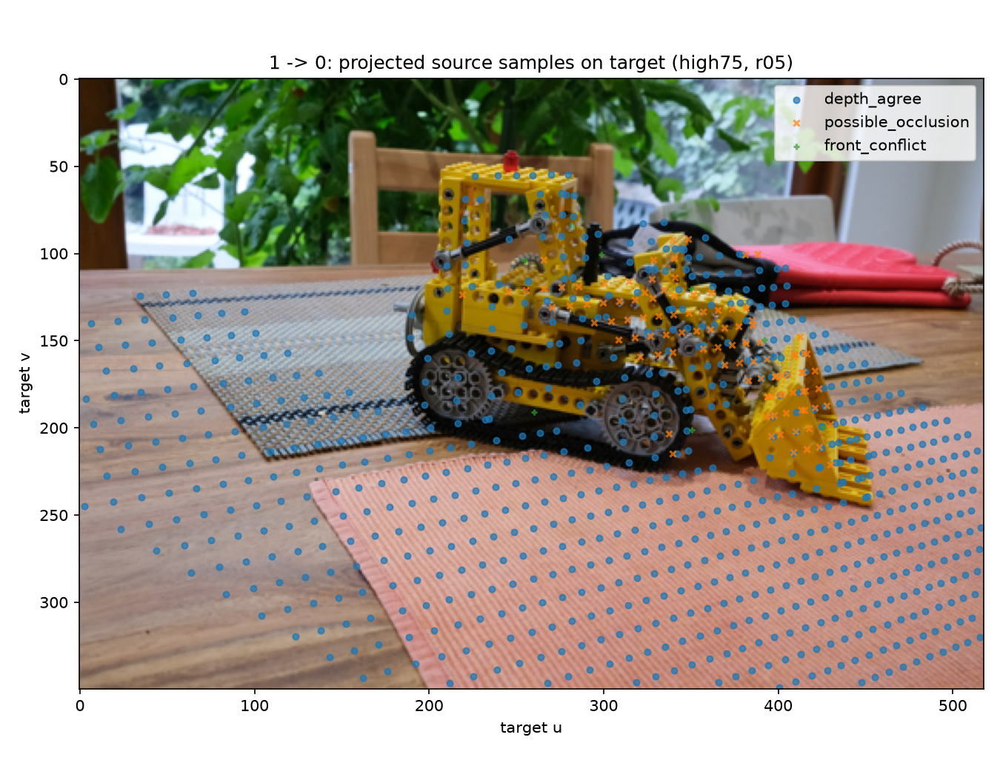

# 跨视图深度一致性与可见性边界

同视图回投通过，不代表一个视图的世界点在另一个视图中得到相同深度支持。
本模块执行双方向投影与目标深度比较，并分别记录无法比较、深度相容和冲突的原因。
默认设置下可比较集合约 87% 相容，但全图相容证据仅约 56%–57%，残差仍有明显长尾。

## 先转换到目标相机，再比较深度

源图 A 的深度反投影得到世界点，以目标图 B 的 `w2c` 转换为目标相机点：

```math
P_{c,B}=R_BP_w+t_B,\qquad
\Delta Z=Z_{\mathrm{projected}}-D_B(u_B,v_B),\qquad
r=\frac{\Delta Z}{D_B(u_B,v_B)}.
```

两幅图的同一 `(u,v)` 通常不是同一个空间位置，深度也属于不同相机坐标系，不能直接逐像素相减。
本实验复用深度分支 `depth_keep`，不使用两路点图的交集 `pair_keep`。
源、目标两端都需要支持；正深度阈值为 `near=1e-6` 模型单位。

先判断连续目标 UV 位于 `[0,517]×[0,349]`，再按 `floor(UV+0.5)` 取最近像素。
画面外的 UV 不裁剪回图内；目标 mask 拒绝或目标深度无效时，残差保留 NaN。
最近邻避免混合前后两层深度，但不能消除深度边界附近的对应歧义。

## 七类互斥状态与统计分母

| 标签 | 状态 | 判定与解释 |
|---:|---|---|
| 0 | `source_rejected` | 源端未选中，不进入后续比较 |
| 1 | `nonprojectable` | 源端已选中，但不能得到有效正 Z 投影 |
| 2 | `outside_target` | 可以投影，连续 UV 在目标边界外 |
| 3 | `target_unsupported` | UV 有界，但目标 mask 或深度不支持 |
| 4 | `depth_agree` | 可比较且 `abs(r) <= ρ` |
| 5 | `possible_occlusion` | `r > ρ`，点位于目标预测表面后方 |
| 6 | `front_conflict` | `r < -ρ`，点位于目标预测表面前方 |

七类相加等于全部源图像素数。可比较集合是标签 4–6，包含两类深度冲突。
所有可比较残差都参与 mean/median/p95/RMSE，不通过删除“可能遮挡”来降低统计差异。
同时报告 `可比较/已选源点`、`相容/可比较`、`相容/全网格`；空分母使用 `null`。

## 默认 high75 / 5% 的真实结果

两幅图均为 350×518，每个方向有 181,300 个源像素。0→1 表示 `00.png→01.png`。
high75 两视图深度阈值为 1.0 和 1.01935613155365；并列分数使图 0 保留全部像素。

| 方向 | 已选源点 | 可比较数 | 相容数 | 可能遮挡 | 前方冲突 |
|---|---:|---:|---:|---:|---:|
| 0→1 | 181,300 | 116,918 | 102,393 | 13,470 | 1,055 |
| 1→0 | 135,975 | 119,084 | 102,812 | 15,416 | 856 |

| 方向 | 源拒绝 | 无法投影 | 画面外 | 目标无支持 | 可比较/已选 | 相容/可比较 | 相容/全图 |
|---|---:|---:|---:|---:|---:|---:|---:|
| 0→1 | 0 | 0 | 41,415 | 22,967 | 64.49% | 87.58% | 56.48% |
| 1→0 | 45,325 | 0 | 16,891 | 0 | 87.58% | 86.34% | 56.71% |

约 87% 的相容率只描述可比较集合，不能解释为整幅图准确率。
不能比较的像素不等于零误差，也不能全部判为预测错误。

| 方向 | 绝对相对差异 mean | median | p95 | 相对 RMSE |
|---|---:|---:|---:|---:|
| 0→1 | 6.87% | 0.52% | 58.13% | 23.27% |
| 1→0 | 6.54% | 0.63% | 59.89% | 18.91% |

这些是无量纲相对差异，以百分数显示，不是像素或米。
中位数约 0.5%–0.6%，p95 却约 58%–60%，表明多数可比较点差异小，同时存在明显的大差异尾部。

## 筛选和容差分别改变什么

固定相对深度容差为 5%，比较置信度档位：

| 方向 | 档位 | 可比较数 | 相容/可比较 | 相容/全图 | 绝对相对 mean | p95 |
|---|---|---:|---:|---:|---:|---:|
| 0→1 | all | 139,885 | 75.26% | 58.07% | 14.50% | 93.71% |
| 0→1 | high75 | 116,918 | 87.58% | 56.48% | 6.87% | 58.13% |
| 0→1 | high50 | 77,519 | 94.70% | 40.49% | 2.07% | 7.65% |
| 1→0 | all | 153,018 | 69.36% | 58.54% | 16.35% | 80.01% |
| 1→0 | high75 | 119,084 | 86.34% | 56.71% | 6.54% | 59.89% |
| 1→0 | high50 | 78,356 | 89.42% | 38.65% | 4.86% | 44.39% |

更严格的筛选保留了更一致的子集，同时缩小支持范围；它没有修改模型预测。
实验另对每组方向与档位检查 2%/5%/10% 容差，共 18 行，见 [direction_summary.csv](results/cross_view/direction_summary.csv)。
固定筛选时，容差只改变相容/后方/前方分类；可比较数及 mean、median、p95、RMSE 完全不变。
这三档是声明的敏感性设置，不是基准测试的通过线，不能仅展示最有利的一行。

## 从目标投影图定位冲突




散点标在目标 RGB 网格，类别二值 mask 标在源图网格；不要混淆两种坐标位置。
散点 stride=12 只用于显示，数值统计使用全网格，详见 [preview.json](results/cross_view/preview/high75_r05/preview.json)。
例如真实 0→1 查询中，源像素 `(170,125)` 投到 `(256.224523,93.396043)`，采样 `(256,93)`。
投影 Z=1.689321，目标深度=1.030620，相对差异约 +63.91%，被标为“可能遮挡”。
这仍可能来自预测、位姿或采样误差，类别名称不能替代对真实遮挡原因的验证。

## 反例、验证与后续接口

24/24 解析检查与真实双方向分析均通过，见 [检查记录](results/cross_view/evidence/day6_check.json) 和 [consistency.json](results/cross_view/consistency.json)。
[三个解析实验](results/cross_view/evidence/visibility_cases.json) 验证了七类分区、深度断层采样以及尺度/平墙歧义。
将全部深度与平移共同乘以 2 可保持相对残差；平墙上的错误横向位姿也可能让剩余重叠区域全部相容。
所以一致性本身不能独立证明米制尺度或相机姿态正确。

当前统计对象是有方向的源像素查询，不是唯一目标像素或唯一三维表面，没有 z-buffer 去重或地图融合。
双方向检查也不等于 A→B→A 像素闭环、独立图像匹配或光度评估。
后续几何接口应同时携带支持 mask、来源与统计边界；把“可能遮挡”直接写成空空间会丢失待验证的信息。

[返回项目总览](README.md)
