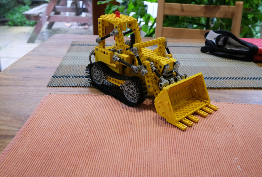
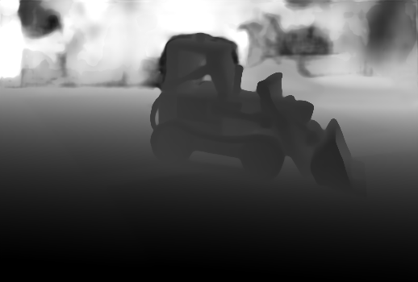
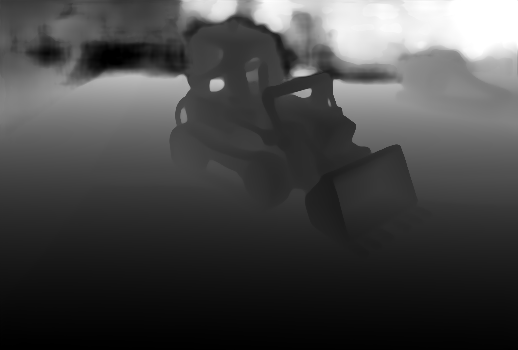
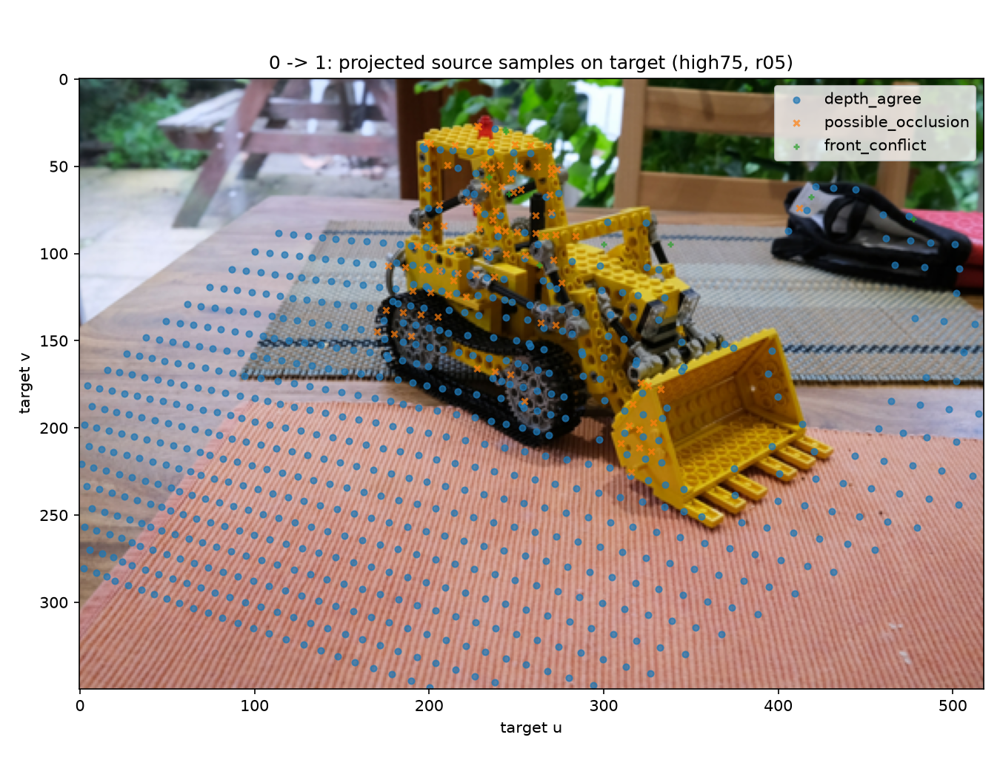

# Visual Geometry Grounded Transformer

**从多视图图像、前馈几何预测到置信度筛选、跨视图诊断与统一几何接口的 VGGT 实验项目。**

本项目使用官方 kitchen 示例中的两张图像，完成原版 VGGT-1B 联合推理，并围绕“输出坐标如何解释、两路几何是否一致、筛选保留了哪些证据”展开检查。双图输出覆盖 **362,600 个处理后像素**，最终保存为包含 **17 个数组字段**的 geometry packet。

严格置信度筛选后，两路点图的平均差异从 **0.05644** 降至 **0.00284 模型单位**，同时共同覆盖率从 **100% 降至 34.98%**。跨视图默认条件下，可比较集合的深度相容率约为 **87%**，占整幅图的相容查询比例约为 **56%–57%**。这些结果描述预测内部的一致性与支持范围，尚无外部几何真值或米制标定。

这是 World Model 系列的 Week 5 项目。仓库沿用 NeRF 项目的展示结构，按技术主题组织说明、精选图和原始实验记录，并保留浮点数组以支持离线复核。完整模型源码、权重和原教学脚本未随展示包分发。

[专题导航](#专题导航) · [实验结果](#实验结果) · [证据索引](SOURCE_INDEX.md) · [校验记录](results/PACKAGE_CHECKS.md) · [资料来源](SOURCES.md)

## 结果预览

| 处理后输入视图 0 | 处理后输入视图 1 |
|---|---|
|  |  |
|  |  |

两张图像联合输入，处理后均为 350 × 518。上排为输入照片，下排为预测相机 Z 深度的显示图，同一次运行使用相同分位数显示范围；灰度值不能当作米制距离。原始数值见[双图输出记录](results/inference/pair_full/run.json)和[数组检查](results/inference/pair_full/inspection/inspection.json)。

## 项目实现了什么

- **模型与数据契约**：固定官方源码和权重版本，明确 batch/view 维度、输入预处理、相机编码与各预测头的输出语义。
- **真实前馈推理**：完成单图 full、双图 camera-depth、双图 full 三种运行，保存相机、深度、点图及运行耗时与显存记录。
- **几何解释与诊断**：独立处理 w2c/c2w、相机中心、Z 深度反投影，同像素比较直接点图与深度路线，并分别报告差异和覆盖率。
- **跨视图与接口验收**：双方向、三档筛选、三档容差共 18 行诊断；导出统一几何接口，保留来源、有效性、支持 mask 与尺度限制。

## 技术流程

```text
Same-scene RGB images
         │
   resize / crop / pad → processed image grid
         │
   patch tokens → frame / global attention
         │
   camera encoding + depth + direct world points + confidence
         │
   decoded K, w2c → depth unprojection → world points
         │
   per-view confidence selection → two-route point comparison
         │
   source-to-target projection → depth consistency / missing support
         │
   geometry packet + provenance + independent checks
```

本次未提供查询点，因此没有运行跟踪分支。各图的共同参考系来自同一次联合推理，不能把两个独立单图预测直接拼成同一个世界。

## 实验设置

| 项目 | 配置 |
|---|---|
| 输入 | 官方 kitchen 示例两图；原图 520 × 779；顺序固定为 00、01 |
| 处理后布局 | `B=1, S=2, H=350, W=518`；每图 181,300 像素 |
| 模型 | 原版 `facebook/VGGT-1B`；预训练权重，不做场景训练或微调 |
| 官方源码 | `a288dd0f14786c93483e45524328726ab7b1b4ce` |
| 权重 revision | `860abec7937da0a4c03c41d3c269c366e82abdf9` |
| 相机约定 | OpenCV w2c；处理后整数像素中心；depth 为相机 Z |
| 置信度筛选 | 每个 batch/view、每条点图路线独立求线性分位数；保留阈值并列 |
| 跨视图设置 | 深度路线；最近像素采样；相对容差 2% / 5% / 10% |
| 历史推理环境 | Windows；Python 3.11.17；PyTorch 2.3.1+cu121；RTX 4060 Laptop GPU 约 8 GiB |
| 推理精度 | FP32 权重；BF16 autocast；eval + inference_mode；导出 float32 预测 |

详细设置见[正式推理与运行诊断](03_Inference_and_Runtime_Diagnostics.md)。两图 full 的首次前向为 **1.731 s**，PyTorch 峰值 allocated 为 **5.237 GiB**；它们是一次历史运行记录，未作为稳定性能基准。

## 实验结果

### 两路点图的差异与覆盖

比较同一像素的深度反投影点和直接点图预测，距离为两点的欧氏距离。两路 mask 的交集构成统计集合，覆盖率分母为两图全部 362,600 个像素。

| 筛选档位 | 共同保留数 | 全网格覆盖率 | 平均距离 ↓ | 中位距离 | p95 距离 |
|---|---:|---:|---:|---:|---:|
| all | 362,600 | 100.00% | 0.05643840 | 0.00384661 | 0.36727088 |
| high75 | 312,731 | 86.25% | 0.03912366 | 0.00348263 | 0.25000343 |
| high50 | 126,854 | 34.98% | 0.00283589 | 0.00259470 | 0.00449167 |

距离单位为模型单位。来源：[点图比较](results/confidence/comparison.json)、[完整汇总 CSV](results/confidence/selection_summary.csv)。

| 全部候选点 | high50 筛选后的点 |
|---|---|
|  |  |

图中采用固定网格抽样和相同显示范围；统计使用完整网格。high50 子集更一致，但覆盖范围明显缩小，不能把点云更整齐解释为整体重建精度提升。high75 的名义保留比例也不保证实际保留 75%，因为阈值并列点全部保留。详见[点图与置信度](05_Point_Maps_and_Confidence.md)。

### 跨视图的深度相容性

默认使用 **high75 深度支持、5% 相对容差**。源世界点投到目标相机，以目标预测深度为分母计算相对 Z 残差。下面的“相容”指该残差绝对值不超过 5%。

| 方向 | 源支持数 | 可比较查询数 | 相容 / 可比较 | 相容 / 全图 | 绝对相对残差 p95 |
|---|---:|---:|---:|---:|---:|
| 0 → 1 | 181,300 | 116,918 | 87.58% | 56.48% | 58.13% |
| 1 → 0 | 135,975 | 119,084 | 86.34% | 56.71% | 59.89% |

来源：[18 行方向统计](results/cross_view/direction_summary.csv)。全图分母均为 181,300，查询未做三维表面去重。两个方向分别保留；图像外、目标无支持和源拒绝不是零残差。较高的集合相容比例与较大的 p95 同时存在，说明长尾分歧仍明显。



图中为 stride=12 的预览抽样。蓝色表示相容，橙色表示可能遮挡，绿色表示前方冲突；后两者都是相对于目标预测深度的诊断类别，不是遮挡真值。详见[跨视图诊断](06_Cross_View_Consistency.md)。

## 专题导航

| 专题 | 核心问题 | 说明 |
|---|---|---|
| 01 模型与接口 | 输入、预测头、坐标和维度怎样衔接 | [Model and Output Contract](01_Model_and_Output_Contract.md) |
| 02 预处理与注意力 | 像素网格怎样改变，多视图怎样交换信息 | [Image Preprocessing and Attention](02_Image_Preprocessing_and_Attention.md) |
| 03 正式推理 | 如何确认模型真实运行，怎样解释耗时和显存 | [Inference and Runtime Diagnostics](03_Inference_and_Runtime_Diagnostics.md) |
| 04 相机与深度 | Z、range、世界点和相机中心有何区别 | [Camera and Depth Geometry](04_Camera_and_Depth_Geometry.md) |
| 05 点图与筛选 | 预测差异下降付出了多少支持范围 | [Point Maps and Confidence](05_Point_Maps_and_Confidence.md) |
| 06 跨视图诊断 | 可比较、相容、遮挡候选分别意味着什么 | [Cross View Consistency](06_Cross_View_Consistency.md) |
| 07 统一接口 | 如何交接可追溯的预测几何先验 | [Geometry Packet and World Model Bridge](07_Geometry_Packet_and_World_Model_Bridge.md) |

## 仓库结构与复核

```text
WM_Week5_VGGT/
├── README.md                  # 项目总览与核心结果
├── 01_*.md … 07_*.md          # 按技术主题组织
├── figures/                   # 首页精选图及图注索引
├── results/
│   ├── contracts/             # 输入输出、源码与环境
│   ├── preprocessing/         # 预处理、注意力诊断
│   ├── inference/             # 三次成功运行和浮点预测
│   ├── geometry/              # 相机与深度反投影
│   ├── confidence/            # 两路线点图与筛选
│   ├── cross_view/            # 方向统计、标签和原始残差
│   ├── geometry_packet/       # 17 字段统一几何接口
│   ├── validation/            # 历史接口验收
│   └── package_validation/    # 本次归档校验与指标复算
├── SOURCE_INDEX.md            # 原始目录与专题证据映射
└── SOURCES.md                 # 方法、代码和图像来源
```

阅读不需要 GPU。整理时已使用本地校验脚本检查 SHA-256、JSON、文档链接和文件大小，并用 NumPy 独立复算保存数组的指标；脚本仅保留在本地，不随仓库上传。

复核仅读取已保存结果，不下载权重或运行 VGGT。几何 packet 本身未收录原始跨视图残差，本仓库另外保留了这些数组，供需要时自行复算 pooled 分位数。验证范围和实测结果见[整理与验证记录](results/PACKAGE_CHECKS.md)。

## 与场景表示和世界模型的连接

NeRF 和 3DGS 项目关注给定观测与相机后如何构建场景表示并渲染；本项目补充从图像直接预测相机和几何的入口。输出可作为后续场景初始化或几何约束，但仍需处理尺度标定、坐标对齐与错误预测。

当前实验是单场景双图案例，未执行 BA、场景微调、新视角渲染或动态长期记忆。相机回投自洽、两路点图一致、跨视图深度相容分别提供不同层面的证据，均不能单独证明真实几何准确性。
